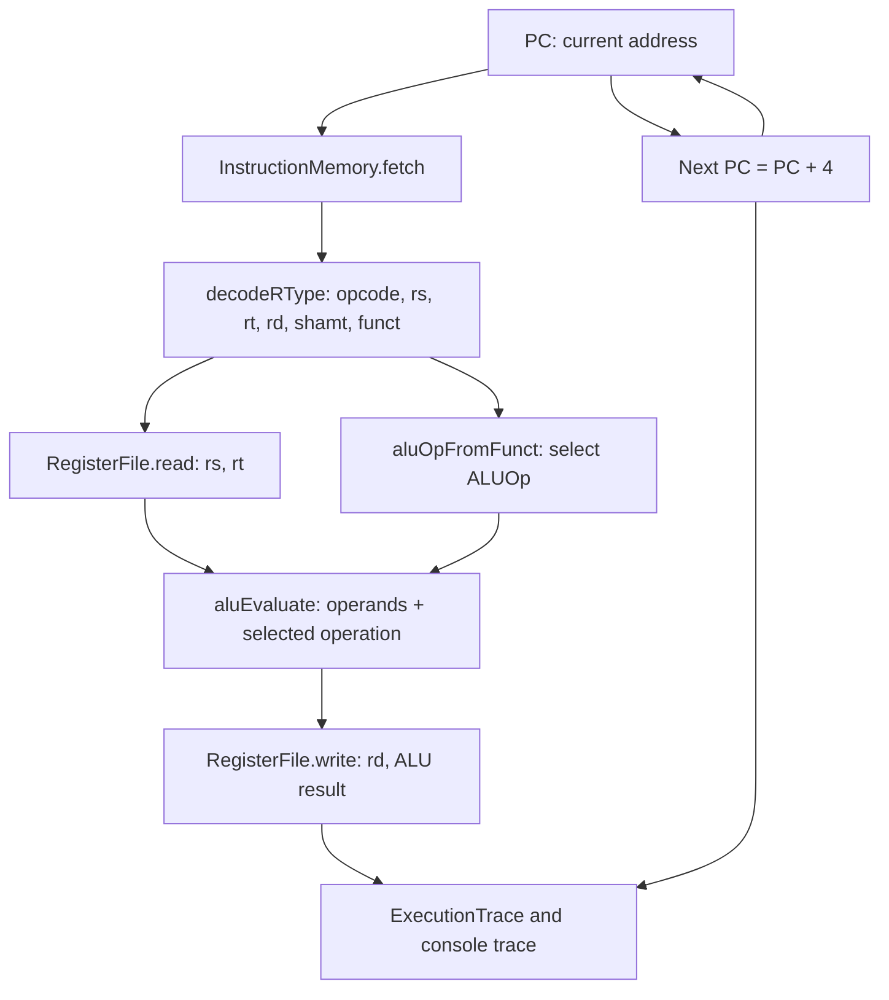

# Single-Cycle MIPS Simulator — Step-by-Step Architecture Guide

**Course:** CS 3339 Computer Architecture  
**Project:** 32-bit MIPS single-cycle processor simulator (R-type subset)  
**Milestone:** 4 — Instruction memory and sequential program execution  
**Status:** CPU fetch, R-type decode, register read, ALU, register write-back, PC+4, and trace work; *this is not yet a full MIPS processor.*

## 0. First, what “single-cycle” means

A classic single-cycle processor completes one instruction's combinational work (fetch/decode/read/ALU/select next PC) between two clock edges, and changes state at the clock edge. The console trace divides that same *one instruction cycle* into explanatory labels. **Do not interpret FETCH, DECODE, READ, EXECUTE and WRITE-BACK as five different clock cycles or a five-stage pipeline.**

This C++ code is a *functional* model, not a gate-level circuit or cycle-accurate timing model: method calls run in sequence while representing the conceptual signal flow. The CPU currently models only sequential R-type instructions and stops at the end of the loaded program by simulator convention.

## 1. High-level component connections



*Note:* This depicts data/control dependencies. For the simulated single-cycle edge, register write-back and PC update logically happen together. A full datapath additionally needs muxes, a main control unit, data memory and branch/jump paths.

## 2. Step-by-step walkthrough: `add $t0, $t1, $t2`

Inputs: `$t1` = 10, `$t2` = 20; machine word `0x012A4020`; starting PC `0x00400000`.

### Step 1 — Program load: instruction memory

- Code: `include/instruction_memory.hpp`, `src/instruction_memory.cpp`.
- Load `0x012A4020` at text address `0x00400000` (next word at `0x00400004`).
- `loadProgram(...)` copies words into a vector; `loadProgramFile(...)` reads one hex word per line, optionally with a `#` comment.
- Interface: `InstructionMemory::fetch(pc) -> uint32_t`.
- Reject unaligned and out-of-bounds fetches.

### Step 2 — Fetch: program counter → instruction word

- Code: `SingleCycleCPU::step()` in `src/cpu.cpp`.
- PC = `0x00400000`; fetch returns `0x012A4020`.
- The PC points to a byte address; each instruction is 4 bytes.
- In this milestone, PC follows **PC + 4 only** (no branch or jump logic).

### Step 3 — Decode: instruction bits → fields

- Code: `decodeRType(...)` in `src/decoder.cpp`; contract in `include/decoder.hpp`.
- R-type bit layout: `[31:26] opcode | [25:21] rs | [20:16] rt | [15:11] rd | [10:6] shamt | [5:0] funct`.
- For `0x012A4020`: `opcode=0`, `rs=9`, `rt=10`, `rd=8`, `shamt=0`, `funct=0x20`.
- `opcode == 0` indicates the R-type format; `funct=0x20` selects ADD.
- The decoder rejects unsupported `funct` values and malformed fixed-shift fields.
- **Team handoff:** Timothy may replace this decoder implementation but should preserve the `DecodedRType` fields and validation contract.

### Step 4 — Read: registers → ALU operands

- Code: `RegisterFile::read(...)` in `src/registers.cpp`.
- Read register 9 (`$t1`) = 10 and register 10 (`$t2`) = 20.
- Register indices are 0–31, stored as 32-bit values (`uint32_t`).
- `$zero` (register 0) always reads 0 and ignores writes.

### Step 5 — Control + Execute: function code → ALU

- Code: `aluOpFromFunct(...)`, `aluEvaluate(...)` in `src/alu.cpp`.
- `funct=0x20` chooses `ALUOp::ADD`.
- Execute signed 32-bit addition: 10 + 20 = 30; Zero flag = false.
- For signed ADD/SUB, overflow raises an exception *before* changing PC or registers.
- Other operations include modular ADDU/SUBU, AND/OR/XOR/NOR, signed/unsigned SLT, and SLL/SRL/SRA.
- Fixed shifts use the `rt` register value and the five-bit `shamt` field.

### Step 6 — Write-back: ALU result → destination register

- Code: `SingleCycleCPU::stepRType(...)` and `RegisterFile::write(...)`.
- Write 30 to `rd=8`, i.e. `$t0` = 30. `$t1`, `$t2` remain 10 and 20.
- No write occurs for `rd=0`; that includes `nop` (`0x00000000`).
- In this model, destination is always `rd` for supported R-type operations; load/store and immediate paths are not implemented.

### Step 7 — Next PC and trace

- Code: `src/cpu.cpp`, `formatTrace(...)`.
- PC changes from `0x00400000` to `0x00400004` (one instruction completed).
- `ExecutionTrace` includes PC before/after, decoded fields, operand values, ALU operation/result, Zero flag and register-write indicator.
- The printed trace names conceptual activities of the *same single cycle*.

### Step 8 — Repeat until program end

- Code: `SingleCycleCPU::run(maxInstructions)`.
- While `pc != instructions.endAddress()`, `step()` fetches and executes the next word.
- At the exact address immediately after the last word, `halted()` returns true and `run()` stops. **This is a simulator stopping rule, not a MIPS halt instruction.**
- If an instruction is unsupported, fetch is invalid, or signed ADD/SUB overflows, execution throws; the failing instruction leaves PC and registers unchanged. Prior completed instructions are not rolled back.
- A maximum-instruction guard prevents unbounded runs. With sequential-only execution, each successful instruction uses one simulated clock cycle.

## 3. Concrete five-instruction example

| Simulated cycle | PC (before) | Assembly | Key register effect |
|---|---|---|---|
| 1 | 0x00400000 | `add $t0, $t1, $t2` | `$t0 = 30` |
| 2 | 0x00400004 | `sub $t3, $t0, $t1` | `$t3 = 20` |
| 3 | 0x00400008 | `and $t4, $t0, $t3` | `$t4 = 20` |
| 4 | 0x0040000C | `sll $t5, $t3, 2` | `$t5 = 80` |
| 5 | 0x00400010 | `nop` | no register change |

After five instructions, PC = `0x00400014`, and the emulator stops because it has reached the end of the loaded program. In a single-cycle model, instruction 2 can immediately use the result of instruction 1 in the next cycle; there are no pipeline forwarding/stall issues.

## 4. Source map and interfaces

| Component | Header / implementation | Input | Output | Owner / integration note |
|---|---|---|---|---|
| Instruction memory | `include/instruction_memory.hpp` / `src/instruction_memory.cpp` | PC byte address | 32-bit instruction | Integration scaffold; agree with team memory owner |
| Instruction decoder | `include/decoder.hpp` / `src/decoder.cpp` | 32-bit word | `DecodedRType` | Timothy-owned implementation can replace reference decoder |
| Register file | `include/registers.hpp` / `src/registers.cpp` | rs/rt index; rd/value on write | 32-bit operand values | Your module |
| ALU control | `aluOpFromFunct` in `src/alu.cpp` | `funct` | `ALUOp` | Agree on control interface with Timothy |
| ALU | `include/alu.hpp` / `src/alu.cpp` | operand A, B, ALUOp, shamt | value + Zero | Your module |
| CPU integration | `include/cpu.hpp` / `src/cpu.cpp` | memory and PC | trace; registers+PC updated | Shared glue code |
| CLI | `src/main.cpp` | default/hex file/single word | console trace | Demo harness |
| Tests | `tests/*.cpp` | known instructions, errors | pass/fail | Regression verification |

### Key public C++ calls

```cpp
SingleCycleCPU cpu;
cpu.registers.write(9, 10);
cpu.registers.write(10, 20);
cpu.loadProgram({0x012A4020u, 0x00000000u});
auto trace1 = cpu.step(); // fetch + decode + ALU + write-back + PC advance
auto rest = cpu.run();     // execute remaining program
```

`cpu.stepRType(word)` remains available for isolated integration tests, but `step()` is the normal program-memory path.

## 5. What we test, and what we do *not* claim

Test suites: `test_core` = 30 checks; `test_integration` = 29; `test_program` = 30; **89 total**. The new suite tests sequential dependencies, memory boundaries, alignment, hex loading, error state preservation, program completion, and instruction limits.

**Not implemented:** I-type/J-type decoding, addi/andi/ori, lw/sw, data memory, beq/bne, branch target selection, jump, complete main control, syscall/assembler, branch delay slots, HI/LO, multiply/divide, interrupts, or hardware propagation timing. There is **no pipeline**. To build a complete single-cycle processor, integrate main control, muxes (ALUSrc/RegDst/MemToReg/PCSrc), data memory and PC target logic.

## 6. Why this is a single-cycle datapath, even though the code is sequential

Hardware: register outputs and combinational logic settle within one long clock cycle. At the clock edge, the destination register and PC update. Software: function calls model the same dependencies in order for readability. **One call to `step()` = one modeled single-cycle instruction**, regardless of how many functions it invokes. Timing in nanoseconds or MIPS pipeline stages is not simulated.

## 7. Recommended presentation explanation

> “Our simulator stores MIPS machine words in instruction memory. The PC selects one word. Timothy's decoder extracts the R-type fields; the register file supplies operands; our ALU control maps the function field to an operation; and the ALU computes the result. The result is written to the destination register, while the PC advances by four. All of this represents one instruction cycle. We repeat for each word and print a trace so you can see the datapath's logical activity.”

## 8. Integration checklist for the team

1. Agree on whether the decoder returns `DecodedRType` or a broader `DecodedInstruction` supporting I/J formats.
2. Keep register indices 0–31 and word values 32-bit (`uint32_t`).
3. Distinguish signed ADD/SUB overflow exceptions from wraparound ADDU/SUBU.
4. Give ALU control a documented enum/signals contract. Unsupported function codes must not silently turn into ADD.
5. Agree on a text base (`0x00400000`) and instruction-memory addressing in bytes.
6. Assign ownership of main control, memory and branch selection so nobody duplicates modules.
7. Run `make test` before merging; merge source files, **not** `demo`/`test_*` binaries.
8. Keep all traces and screenshots grounded in actual simulator runs.
