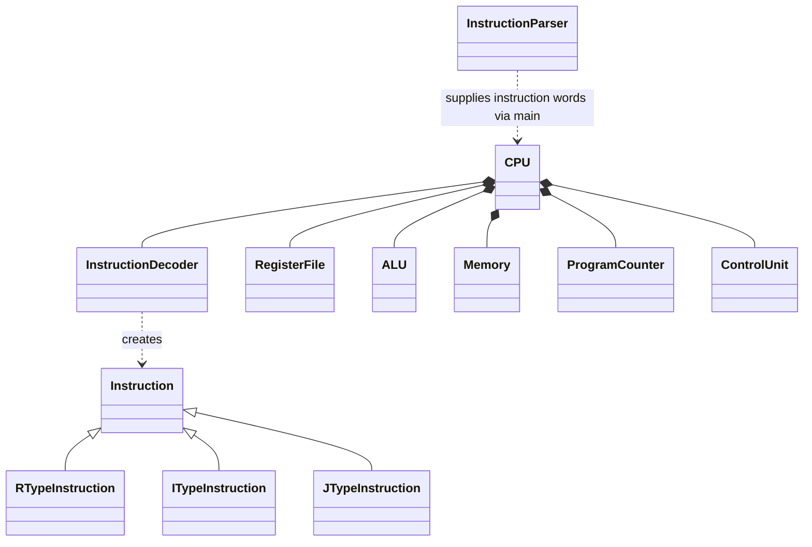

<!-- Assigned to: Timothy Sparks, Tony McFarlan, Haddon Stauffer, Zunain Nazir (shared documentation). -->
# Project blueprint

This scaffold follows the responsibilities in the existing project proposal.
Headers declare planned interfaces and storage; source files reserve space for
their owners. No parsing, decoding, execution, memory access, or state display
is implemented. Interfaces can be refined together before implementation.

## Layout

```text
mips-simulator/
├── Makefile                  Build the scaffold with C++17
├── README.md                 Existing proposal and assignments
├── include/mips/             Component declarations
│   ├── instruction.h         Instruction base and R/I/J subclasses
│   ├── parser.h              Assembly input interface
│   ├── decoder.h             Instruction decoding interface
│   ├── registers.h           Register file interface
│   ├── alu.h                 ALU interface
│   ├── memory.h              Data memory interface
│   ├── program_counter.h     Program counter interface
│   ├── control.h             Control unit interface
│   └── cpu.h                 Processor composition
├── src/                      Matching .cpp placeholders and main.cpp
├── docs/                     Architecture and future project documentation
├── programs/                 Future assembly workloads
└── tests/                    Future component and integration tests
```

## Class hierarchy



Only instruction formats use inheritance. CPU owns the independent processor
components through composition. Its instruction-word vector reserves storage
for the program; Memory represents data memory.

The planned flow is assembly input → parser → instruction words → CPU.
For each future step, CPU will fetch a word, ask the decoder for its instruction
fields, obtain control signals, coordinate the registers/ALU/memory, and update
the program counter. This flow is documentation only.

## Ownership

| Files | Assigned person | Planned responsibility |
|---|---|---|
| parser, decoder, instruction | Timothy Sparks | Assembly parsing, labels, formats, opcodes, fields |
| registers, alu | Tony McFarlan | Register access, arithmetic/logical operations, R-type support |
| memory | Haddon Stauffer | Data storage, load/store, I-type support |
| program_counter, control, cpu, main | Zunain Nazir | Execution coordination, sequential flow, branches and jumps |
| Makefile, docs, tests, programs | All four team members | Shared setup, verification, documentation |

Each component name refers to its header and matching source file.
CPU integration will need Tony's R-type work and Haddon's I-type/load-store work;
Zunain owns branch/jump behavior even though branches use the I-type format.
Shared ownership above names Timothy Sparks, Tony McFarlan, Haddon Stauffer,
and Zunain Nazir; it does not introduce another individual assignment.

## Build the blueprint

From the repository root, with GNU Make and a C++17 compiler installed:

```sh
make
./build/mips-simulator
make clean
```

The executable immediately returns success and produces no output.
The build checks that component declarations and source files compile.
Component methods intentionally have no definitions; calling them will require
their assigned implementation first. There are no behavioral tests yet.
