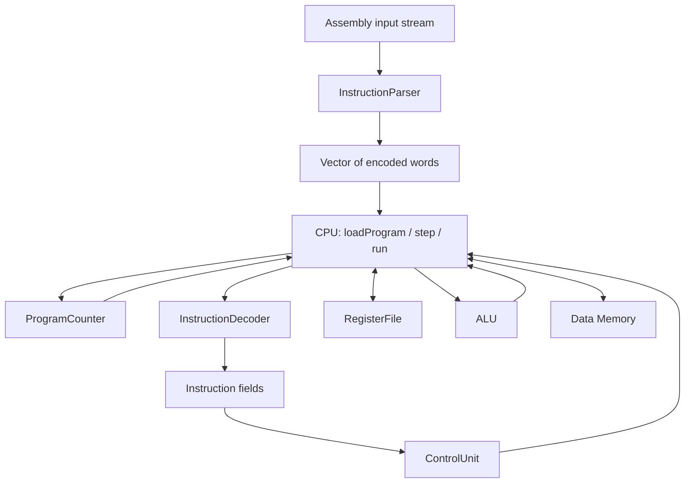

# MIPS simulator: implementation spec and pseudocode

This guide turns the existing interfaces into a proposed implementation contract
for Timothy Sparks, Tony McFarlan, Haddon Stauffer, and Zunain Nazir. It describes
what to build; it does not mean the scaffold already implements these features.
The instruction subset and ownership come from the project proposal. Defaults
such as memory size, address layout, and error handling below are project design
choices. If an instructor requirement differs, update this shared contract first.

## Start here: what you are actually building

A processor repeatedly reads an instruction, works out what it asks for, and
changes its stored state. Your simulator represents those actions with C++ objects
and functions. The MIPS registers are entries in an array, data memory is a vector
of bytes, and the program counter is an integer. You do not need to reproduce
transistors or build a circuit to simulate the observable results of instructions.

There are two programs involved. The **host program** is your C++ executable,
running on your computer. The **simulated program** is the MIPS assembly file that
your executable reads. When the simulated program says `add`, your C++ program
reads two entries from its register array, computes a result, and writes another
entry. Your computer is executing the C++ implementation of that behavior.

**State** means the information that survives between simulated instructions:
register values, data-memory contents, and the PC. An instruction is a rule for
turning the old state into the next state. That gives you a useful way to approach
every feature: write down the starting state, execute one instruction, then check
which values should have changed and which should have stayed the same.

For example, if `$t1` contains 5 and `$t2` contains 7, then:

```asm
add $t0, $t1, $t2
```

means “read `$t1` and `$t2`, add their values, and put the result in `$t0`.” It
does not change `$t1` or `$t2`. It also moves execution to the next instruction.
The `$` names identify simulated registers; they are not C++ variables that you
need to declare separately.

### A few terms to learn first

| Term | Meaning in this project |
|---|---|
| Bit | One binary digit, either 0 or 1 |
| Byte | Eight bits; the smallest individually addressed unit in our data memory |
| Word | 32 bits, or four bytes, for this MIPS model |
| Register | One of 32 small storage locations used directly by arithmetic instructions |
| Register file | The collection of those registers; “file” does not mean a disk file |
| Address | A number identifying a storage location; different from the value stored there |
| Operand | An input or destination named by an instruction, such as a register or constant |
| Immediate | A constant encoded inside an instruction, such as the `5` in `addi` |
| Opcode | A numeric field identifying an instruction operation or group |
| PC | Program counter: the byte address of the instruction to execute next |
| Fetch | Read the encoded instruction at the PC |
| Decode | Extract instruction fields and identify their meaning |
| Execute | Carry out the requested operation |
| Writeback | Store an instruction's result in its destination register |
| Datapath | The route values take through registers, the ALU, memory, and result selection |

Numbers such as `12`, `0x0000000C`, and binary `1100` can represent the same
value. The `0x` prefix means hexadecimal, or base 16. Each hex digit represents
four bits, so eight hex digits show an entire 32-bit word compactly. This is why
instruction encodings and register dumps usually use hexadecimal.

### How to use this document

Read sections 1–3 together to understand the shared rules. Then read your assigned
component section and section 9's execution example. When you begin connecting
components, follow section 8 one step at a time. Section 11 tells you what evidence
to collect before considering a feature complete.

The pseudocode describes algorithms; it is not C++ to paste into the project.
`require` means check a condition and throw an exception if it fails. “Create”
means construct a C++ object. “Pending” means remember a proposed change in a local
variable until validation finishes. Names such as `checkedSigned` describe helpers
you may implement; they are not existing standard-library functions.

## 1. Quick spec sheet

| Item | Baseline contract |
|---|---|
| Model | Single-cycle architectural simulator: one successful `step()` executes one instruction |
| Language | C++17; declarations in `include/mips/`, definitions in `src/` |
| Instructions | `add sub and or slt addi andi ori lw sw beq bne j jal` |
| Registers | 32 registers, each holding a 32-bit bit pattern |
| Register zero | Reads return zero; writes have no effect |
| Reset | All registers and data bytes become zero; PC becomes zero; loaded program stays loaded |
| Instruction storage | Vector of 32-bit words, starting at byte address 0 |
| Data storage | Separate byte vector, 65,536 bytes, addresses 0 through 65,535 |
| Address units | PC, labels, and memory addresses are byte addresses; vector instruction indices are word indices |
| Word alignment | Instruction fetch and `lw`/`sw` addresses must be divisible by 4 |
| Byte order | Little-endian: least-significant byte goes at the lowest address |
| Branch model | No delay slots; a taken branch or jump takes effect immediately |
| Link value | `jal` writes the current instruction address plus 4 into register 31 |
| Arithmetic | `add`, `sub`, and `addi` report signed overflow; address arithmetic wraps to 32 bits |
| Termination | PC equal to the byte address immediately after the program means normal completion |
| Invalid fetch | PC outside the program, except its exact end, is an error |
| Run limit | Stop with an error after 1,000,000 executed instructions if not complete |
| Errors | Throw descriptive standard exceptions; `main` prints the error and returns failure |
| Excluded initially | Pipelining, syscalls, pseudo-instructions, `.data`, stack conventions, exception handlers, `jr` |

These are educational address spaces, not the default MARS memory map. Instruction
address 0 and data address 0 refer to different storage. A store cannot modify an
instruction. See the comparison procedure in section 12 before claiming MARS
equivalence.

Single-cycle means no architectural overlap between instructions. It does not
mean one host CPU clock cycle, nor does this version model electrical timing.

## 2. File ownership and connections

| Owner | Files, excluding extensions | Responsibility | Depends on |
|---|---|---|---|
| Timothy | `parser`, `instruction`, `decoder` | Text to words; words to typed fields | Shared encoding and address rules |
| Tony | `registers`, `alu` | Register storage and arithmetic/logic | Shared numeric rules |
| Haddon | `memory` | Byte storage, word access, bounds and alignment | Shared address and byte-order rules |
| Zunain | `program_counter`, `control`, `cpu`, `main` | Next address, control signals, execution, CLI | All interfaces above |
| Everyone | `tests/`, `programs/`, documentation | Component checks, integration, MARS comparisons | Agreed expected results |

Tony helps integrate R-type execution. Haddon helps integrate immediate and
load/store execution. Zunain owns branches even though they use the I-type format.



The parser handles source syntax. The decoder handles bits. The control unit
decides which actions an instruction requires. The CPU performs those actions.
The register file, ALU, and memory do not parse assembly or advance the PC.

Headers are contracts other files compile against. Put ordinary method bodies in
the matching `.cpp`, and include its header there. Never include another `.cpp`.
Use the existing `mips` namespace. CPU owns its components by composition; only
instruction formats use inheritance. Keep decoded instructions as data, rather
than adding a second execution engine to the instruction subclasses.

For example, `registers.h` tells the CPU that `read(index)` exists and returns a
32-bit value. `registers.cpp` contains the loop or array access that makes it work.
The compiler checks the CPU's calls using the header, then the linker connects
those calls to the compiled definitions. A declared method with no definition
will cause a linker error once something calls it.

Work on a component through its public methods. CPU should call
`registers_.write(8, value)` instead of reaching into the array. This keeps the
register rules in one place and means Tony can fix register behavior without
requiring everyone else to rewrite their code. Similarly, Haddon owns the details
of converting between words and memory bytes.

## 3. Shared notation and instruction rules

### Registers, values, and instruction fields

An instruction contains **register numbers**, not a copy of those registers'
current values. In `add $t0, $t1, $t2`, the encoded fields identify registers 8,
9, and 10. The CPU reads their current values only when it executes the word.
Executing that same instruction later can therefore produce a different result.

The field names have specific roles:

- `rs` identifies a source register, often the first arithmetic input or memory base.
- `rt` identifies a second register. Depending on the instruction, it can be a
  source or a destination.
- `rd` identifies the destination for our supported R-type instructions.

For `add $t0, $t1, $t2`, `rd=8`, `rs=9`, and `rt=10`. For
`addi $t0, $t1, 5`, `rt=8`, `rs=9`, and the immediate is 5; there is no `rd`
field in that format. Read the operand order from the instruction table instead
of assuming the first written operand always has the same field name.

### Signed values and extending immediates

A register stores bits. Those bits do not carry a separate “signed” label.
`0xFFFFFFFF` means 4,294,967,295 when interpreted as unsigned, or -1 when
interpreted as a signed two's-complement 32-bit number. The instruction decides
which interpretation matters. Our `slt` uses signed comparison, so -1 is less
than 0 even though its unsigned bit pattern represents a large number.

An I-type instruction has room for only 16 immediate bits, while the ALU uses
32-bit operands. **Sign extension** copies the original sign bit into the new
upper bits, preserving a signed value. **Zero extension** fills those bits with
zero, preserving an unsigned value or mask:

| Raw 16-bit immediate | Sign-extended to 32 bits | Zero-extended to 32 bits |
|---|---|---|
| `0x0005` | `0x00000005` = 5 | `0x00000005` = 5 |
| `0xFFFF` | `0xFFFFFFFF` = signed -1 | `0x0000FFFF` = 65535 |
| `0x8000` | `0xFFFF8000` = signed -32768 | `0x00008000` = 32768 |

This is why one generic “convert immediate” rule would be wrong: arithmetic and
offset instructions need signed values, while `andi` and `ori` use zero-extended
bit masks. The parser still enforces the source-literal ranges specified below.

**Overflow** occurs when a mathematical signed result does not fit in 32 signed
bits. Adding 1 to 2,147,483,647 is the simplest example. For `add`, `sub`, and
`addi`, report the error before writing a result. **Wrapping** instead keeps only
the lowest 32 bits; the guide uses that for raw ALU results and address arithmetic.
Do not confuse either behavior with a C++ signed overflow, which you must avoid.

### Reading the pseudocode notation

In the pseudocode:

- `R[n]` means the value returned by the register file, not direct array access.
- `u32(x)` means reduce an integer modulo 2^32 to obtain a 32-bit bit pattern.
- `signed32(x)` means `x` when `x < 2^31`, otherwise `x - 2^32`.
- `signed16(x)` means `x` when `x < 32768`, otherwise `x - 65536`.
- `PC` always means the address of the instruction currently executing.
- `sequential = u32(PC + 4)`.
- `checkedSigned(x)` rejects values outside -2^31 through 2^31-1 and otherwise returns `u32(x)`.

Implement signed interpretation and overflow checks with 64-bit intermediate
integers. Avoid C++ signed overflow, shifting negative signed integers, and relying
on out-of-range unsigned-to-signed casts. Cast memory bytes to `uint32_t` before
shifting. Store immediate fields as raw bits; interpret them when executing.

### Encoding and behavior

Opcode and function values below are hexadecimal. Normal instructions advance to
`sequential`; branches and jumps use the rules in their rows.

| Instruction syntax | Format | Opcode / function | Effect |
|---|---|---|---|
| `add rd, rs, rt` | R | `00 / 20` | `R[rd] = checkedSigned(signed32(R[rs]) + signed32(R[rt]))` |
| `sub rd, rs, rt` | R | `00 / 22` | Same signed check, with subtraction |
| `and rd, rs, rt` | R | `00 / 24` | `R[rd] = R[rs] & R[rt]` |
| `or rd, rs, rt` | R | `00 / 25` | `R[rd] = R[rs] \| R[rt]` |
| `slt rd, rs, rt` | R | `00 / 2A` | `R[rd] = 1` if signed `rs < rt`, otherwise 0 |
| `addi rt, rs, imm` | I | `08` | Checked signed addition of `R[rs]` and `signed16(imm)` |
| `andi rt, rs, imm` | I | `0C` | `R[rt] = R[rs] & zeroExtend(imm)` |
| `ori rt, rs, imm` | I | `0D` | `R[rt] = R[rs] \| zeroExtend(imm)` |
| `lw rt, offset(rs)` | I | `23` | `R[rt] = memory.loadWord(u32(R[rs] + signed16(offset)))` |
| `sw rt, offset(rs)` | I | `2B` | Store `R[rt]` at that same effective-address calculation |
| `beq rs, rt, label` | I | `04` | If register bit patterns equal, next PC is `u32(sequential + 4 * signed16(imm))` |
| `bne rs, rt, label` | I | `05` | Same branch calculation, taken when register bit patterns differ |
| `j label` | J | `02` | Next PC is `(sequential & 0xF0000000) \| (target << 2)` |
| `jal label` | J | `03` | Same jump; also `R[31] = sequential` |

These instruction encodings and arithmetic behaviors can be checked against the
[MARS instruction implementation](https://github.com/dpetersanderson/MARS/blob/main/mars/mips/instructions/InstructionSet.java).
The choice to execute without delay slots follows an available MARS mode; its
[settings documentation](https://dpetersanderson.github.io/Help/MarsHelpSettings.html)
explains that mode. This is not a claim to implement all classic MIPS behavior.

`jal` is included because the proposal lists it. A conventional function return
requires `jr`, which is outside this subset. Test the jump and saved link value;
do not promise full function-call support yet.

## 4. Timothy: parser, instruction objects, decoder

### Why these are three separate jobs

The parser understands human-written text: spaces, commas, register aliases,
labels, and numbers. Its output is a vector of instruction words. At that point,
the CPU does not need the original spelling of the instructions to execute them.

The decoder works in the opposite direction at the bit-field level: it turns
one encoded word into named fields the CPU can use. It does not need to rebuild
the original source line. Keeping these separate also lets the team test the CPU
with manually encoded words before the parser is complete.

The instruction classes are containers for those decoded fields. R-, I-, and
J-type are **layouts of bits**, not three execution phases. R-type leaves room
for three register numbers, I-type makes room for a 16-bit immediate, and J-type
makes room for a larger jump target. They all occupy exactly one 32-bit word.

### Assembly input contract

Accept blank lines, `#` comments, and one instruction per line. A label may occupy
its own line or precede an instruction. Labels are case-sensitive and match
`[A-Za-z_][A-Za-z0-9_]*`. Normalize mnemonics and register aliases to lowercase.
Allow whitespace around commas and parentheses. Accept an optional standalone
`.text` marker with no address operand; reject other directives initially.

Accept numeric registers `$0` through `$31` and these aliases:

| Numbers | Aliases |
|---|---|
| 0–3 | `$zero`, `$at`, `$v0`, `$v1` |
| 4–7 | `$a0`–`$a3` |
| 8–15 | `$t0`–`$t7` |
| 16–23 | `$s0`–`$s7` |
| 24–27 | `$t8`, `$t9`, `$k0`, `$k1` |
| 28–31 | `$gp`, `$sp`, `$fp` (also `$s8`), `$ra` |

Accept signed decimal or `0x` hexadecimal integer literals. For `addi` and memory
offsets, require their mathematical value to fit -32768 through 32767. Thus `-1`
is accepted but positive `0xFFFF` is rejected for those operands. For `andi` and
`ori`, accept 0 through 65535. This is a deliberately simple source grammar;
MARS may accept additional equivalent spellings.

Branch and jump operands must be labels initially. Reject unknown labels,
duplicate labels, wrong operand counts, trailing garbage, unsupported operations,
and out-of-range values. Do not silently truncate an invalid operand.

### Why two parsing passes?

A branch can refer to a label appearing later. The first pass assigns addresses;
the second resolves operands and emits words.

Think of a label as a name attached to an address. It does not allocate a register,
occupy an instruction slot, or perform an action at runtime. With instructions at
addresses 0, 4, and 8, a label immediately before the third instruction names
address 8. A label on a line by itself names the address of the following
instruction, or the program's end if no instruction follows it.

For example, while reading `beq $t0, $t1, finish`, the parser might not yet have
seen `finish:`. The first pass can record that unresolved line and continue
counting instruction addresses. Once all labels are known, the second pass can
calculate the branch's offset. Keep the source line number with each recorded
instruction so a bad operand produces a useful message such as “line 7: unknown
register `$t10`.”

```text
parse(stream):
    labels = empty map
    pending = empty list
    address = 0                         // use a wide integer while counting

    for each input line with line number:
        remove text after '#'; trim whitespace
        skip if empty
        if a leading label exists:
            validate spelling and reject duplicates
            labels[label] = address
            remove label and ':'; trim remaining text
        skip if remaining text is empty or exactly '.text'
        validate mnemonic and basic operand syntax
        append (address, line number, instruction text) to pending
        address += 4
        reject a program whose end address cannot fit uint32_t

    words = empty vector
    for each pending instruction:
        parse registers and integer operands with full-token validation
        look up opcode, function code, and operand layout
        for beq/bne:
            targetAddress = labels[label], or error
            difference = targetAddress - (instructionAddress + 4)
            require difference divisible by 4
            immediate = difference / 4; require signed 16-bit range
        for j/jal:
            targetAddress = labels[label], or error
            require targetAddress divisible by 4
            require its upper 4 bits equal those of instructionAddress + 4
            target = (targetAddress >> 2) & 0x03FFFFFF
        encode validated fields; append word
    return words
```

Use these layouts; operands must already be validated before masking:

```text
R: [opcode:6][rs:5][rt:5][rd:5][shiftAmount:5][function:6]
I: [opcode:6][rs:5][rt:5][immediate:16]
J: [opcode:6][target:26]

R word = (rs << 21) | (rt << 16) | (rd << 11) | function
         // opcode and shiftAmount are zero for our supported R operations
I word = (opcode << 26) | (rs << 21) | (rt << 16) | (immediate & 0xFFFF)
J word = (opcode << 26) | target
```

Perform packing with unsigned 32-bit operands. These are shift counts measured
in bits, not byte addresses.

### Instruction objects and decoding

Each `format()` override just returns its corresponding `InstructionFormat` enum.
The virtual base destructor already allows safe deletion through the base pointer.

The decoder uses shifts and masks to isolate fields. Shifting right moves the
field down to the lowest bits; a mask clears everything outside that field. For
example, `(word >> 21) & 31` extracts the five `rs` bits. Here 31 is binary
`11111`, so `& 31` keeps exactly five low bits. A five-bit field can hold numbers
0–31, which is exactly the range of MIPS register numbers.

`std::unique_ptr<Instruction>` lets the decoder return one common pointer type
while owning an R-, I-, or J-type object. When that pointer goes out of scope, its
object is deleted automatically. Use `std::make_unique` to create the appropriate
subclass; do not manually call `delete` on the object owned by the pointer.

```text
decode(word):
    opcode = (word >> 26) & 0x3F
    if opcode == 0:
        extract function = word & 0x3F
        require function in {0x20, 0x22, 0x24, 0x25, 0x2A}
        require ((word >> 6) & 0x1F) == 0
        create RTypeInstruction
        set opcode, rs=(word>>21)&31, rt=(word>>16)&31, rd=(word>>11)&31
        set shiftAmount=0 and functionCode=function
    else if opcode in {0x02, 0x03}:
        create JTypeInstruction; set opcode and target=word & 0x03FFFFFF
    else if opcode in {0x08, 0x0C, 0x0D, 0x23, 0x2B, 0x04, 0x05}:
        create ITypeInstruction
        set opcode, rs=(word>>21)&31, rt=(word>>16)&31
        set immediate=word & 0xFFFF
    else:
        error: unsupported encoding
    return unique_ptr owning the object
```

Do not treat every nonzero opcode as an I-type instruction. The all-zero word
encodes an unsupported operation in this subset; it is not a halt instruction.

## 5. Tony: registers and ALU

### RegisterFile

Registers are the CPU's small working storage. Arithmetic instructions operate
on register values; they do not directly add two arbitrary data-memory locations.
The names `$t0`, `$s0`, and so on are aliases for array indices. At this stage,
their calling-convention meanings do not require different storage behavior:
register 8 and register 16 are both ordinary 32-bit slots.

Register 0 is the exception. MIPS defines it as a permanent source of zero.
For example, `addi $t0, $zero, 5` creates the value 5 by adding it to zero.
Ignoring writes to register 0 and returning zero on reads makes this rule hold
regardless of which CPU instruction uses the register file.

The private fixed-size array is the only register storage. Validate indices before
using them; values 32 through 255 can still fit the public `uint8_t` index type.
Parser validation must occur before narrowing a wider number to `uint8_t`.

```text
reset():
    fill all 32 entries with zero

read(index):
    require index < 32, otherwise out_of_range
    if index == 0: return 0
    return registers[index]

write(index, value):
    require index < 32, otherwise out_of_range
    if index != 0: registers[index] = value
```

The CPU should not duplicate the zero-register rule. Even a load into `$zero`
must perform its memory access and validation; only its final register write is
discarded. Arithmetic into `$zero` must still detect overflow.

### ALU

ALU stands for arithmetic logic unit. Its job is deliberately small: receive an
operation choice and two values, and return a value. For example,
`execute(Add, 5, 7)` returns 12. It does not know which registers supplied those
numbers or where the result will be written. CPU handles those decisions.

AND and OR operate on corresponding bits, rather than treating the whole number
as a true/false condition. With four-bit examples, `1010 AND 1100 = 1000`, while
`1010 OR 1100 = 1110`. In C++, these are `&` and `|`, not `&&` and `||`.
SetLessThan returns the numeric value 0 or 1, so a later instruction can use the
comparison result like any other register value.

The ALU has no persistent state. Its current API describes operations, not the
instruction using them. Therefore Add/Subtract produce wrapped bit patterns;
the CPU separately checks overflow for instructions that require a signed trap.
This allows the same Add operation to calculate memory addresses without a
signed-overflow trap.

```text
execute(operation, left, right):
    switch operation:
        Add:         return u32(left + right)
        Subtract:    return u32(left - right)
        And:         return left & right
        Or:          return left | right
        SetLessThan: return 1 if signed32(left) < signed32(right), else 0
        otherwise:   error: invalid ALU operation
```

## 6. Haddon: data memory

Memory is larger storage accessed through addresses. If data address 100 contains
the value 42, the address is 100 and the stored value is 42. Keeping those roles
separate is especially important for loads and stores.

MIPS uses load/store instructions to move data between memory and registers:

```asm
lw $t0, 8($s0)     # read a word from memory into $t0
sw $t0, 8($s0)     # write the word in $t0 into memory
```

If `$s0` holds 100, both instructions access byte address `100 + 8 = 108`.
The load reads bytes 108–111 and changes `$t0`. The store reads `$t0` and changes
those four bytes. Neither instruction changes `$s0`. The `8` is a byte offset,
so do not multiply it by four. The resulting address is called the **effective
address**.

**Alignment** means a word starts at a multiple of four: 0, 4, 8, and so on.
Our contract rejects a word access at address 6 even if bytes 6–9 exist. This is
a separate check from **bounds**, which asks whether every requested byte belongs
to the allocated memory. The last valid word starts at 65,532 because it occupies
bytes 65,532 through 65,535.

The byte vector makes addresses correspond directly to byte indices. It also
requires an explicit choice of **endianness**, the order of the four bytes of a
word. We use little-endian order and construct words explicitly so the simulated
result does not depend on the host computer's byte order.

`Memory` stores bytes; CPU supplies effective addresses. `loadWord` and `storeWord`
must enforce alignment and bounds themselves so they also work safely in isolation.

```text
initialize(sizeBytes):
    require 0 < sizeBytes <= 2^32 and sizeBytes divisible by 4
    allocate exactly sizeBytes zero bytes

reset():
    zero existing bytes, preserving allocation size

validateWordAccess(address):
    require address divisible by 4
    require bytes.size >= 4
    require address <= bytes.size - 4
    // checking address + 3 with uint32_t could overflow

loadWord(address):
    validateWordAccess(address)
    result = 0 as uint32_t
    for i = 0 through 3:
        result |= uint32(bytes[address + i]) << (8 * i)
    return result

storeWord(address, value):
    validateWordAccess(address)           // before changing any bytes
    for i = 0 through 3:
        bytes[address + i] = (value >> (8 * i)) & 0xFF

display(output):
    print address and value for each nonzero aligned word, in address order
    print a short indication if all words are zero
    preserve the caller's stream formatting flags and fill character
```

Example: storing `0x12345678` at address 4 produces bytes `78 56 34 12` at
addresses 4, 5, 6, and 7. A later load at address 4 reconstructs `0x12345678`.
Use `invalid_argument` for alignment and `out_of_range` for bounds failures.

## 7. Zunain: program counter and control

### ProgramCounter

The PC is the simulator's place in the program. Before executing an instruction,
it tells CPU where to fetch. After execution, it holds the address to fetch next.
It contains an address, not an instruction word or the number of instructions
already executed.

Every instruction in this subset occupies four bytes. Therefore the first three
instruction addresses are 0, 4, and 8, while their vector indices are 0, 1, and 2.
The conversion is `index = PC / 4`. This is why ordinary advancement adds four.
The ProgramCounter class simply stores and updates that value; it does not decide
whether a branch condition is true.

```text
reset():       byteAddress = 0
value():       return byteAddress
set(address):  require address divisible by 4; byteAddress = address
advance():     byteAddress = u32(byteAddress + 4)
```

This object does not know the program length. CPU validates fetch bounds.
During `CPU::step`, use `set(nextPC)` exactly once. Do not call `advance()` as
well, which would move the PC twice.

### What control signals mean

The same hardware components are reused for many instructions. An `add` sends
two register values to the ALU and writes its result to a register. An `lw` uses
the ALU to calculate an address, reads memory, then writes the memory result to
a register. A `sw` calculates an address but writes memory instead of a register.

Control signals describe those choices. In a circuit, a multiplexer selects one
of several inputs. In your C++ simulator, an `if` or conditional expression can
make the equivalent choice: use the register value or immediate, choose `rd` or
`rt`, choose the ALU result or loaded value. The booleans document which route
an instruction needs; they are not separate instructions to execute.

For `lw`, `registerWrite=true` means “a register receives a result,” while
`memoryToRegister=true` means “that result comes from memory.” Those describe
different decisions. For `sw`, `registerWrite` stays false because storing a value
does not change the source register.

| Signal | Meaning when true |
|---|---|
| `registerWrite` | Commit a register result |
| `memoryRead` | Read a word from data memory |
| `memoryWrite` | Write a word to data memory |
| `memoryToRegister` | Register result comes from memory rather than the ALU |
| `aluSourceImmediate` | ALU right operand comes from the immediate |
| `destinationIsRd` | Normal destination is `rd`; otherwise it is `rt` |
| `branch` | Instruction is a conditional branch, whether or not taken |
| `jump` | Instruction is a jump |
| `link` | Override writeback destination with 31 and value with `PC + 4` |

Start with `ControlSignals{}` so every boolean is false. Set only the signals
listed below. Leave irrelevant ALU operations at their default; do not execute
the ALU for jumps.

| Instruction | ALU operation | True signals |
|---|---|---|
| `add` | Add | registerWrite, destinationIsRd |
| `sub` | Subtract | registerWrite, destinationIsRd |
| `and` | And | registerWrite, destinationIsRd |
| `or` | Or | registerWrite, destinationIsRd |
| `slt` | SetLessThan | registerWrite, destinationIsRd |
| `addi` | Add | registerWrite, aluSourceImmediate |
| `andi` | And | registerWrite, aluSourceImmediate |
| `ori` | Or | registerWrite, aluSourceImmediate |
| `lw` | Add | registerWrite, aluSourceImmediate, memoryRead, memoryToRegister |
| `sw` | Add | aluSourceImmediate, memoryWrite |
| `beq`, `bne` | Subtract, unused by this execution plan | branch |
| `j` | Unused | jump |
| `jal` | Unused | jump, link, registerWrite |

`decode(instruction)` identifies an R operation from its function code and an
I/J operation from its opcode, then returns the matching row. Reject unsupported
or inconsistent format/opcode combinations. When accessing derived fields, first
check the format and use a checked cast or an explicitly enforced decoder invariant.

The current signals have no immediate-extension selector and no branch-condition
selector. For this baseline, CPU chooses extension using the opcode, and
`nextAddress` chooses equality versus inequality using the opcode. Additional
signals could make those choices explicit later; no header change is required now.

```text
nextAddress(currentAddress, instruction, registers):
    sequential = u32(currentAddress + 4)
    if instruction is beq or bne:
        equal = registers.read(rs) == registers.read(rt)
        taken = equal for beq, otherwise not equal
        if taken: return u32(sequential + 4 * signed16(immediate))
    if instruction is j or jal:
        return (sequential & 0xF0000000) | (target << 2)
    return sequential
```

Compute branch arithmetic in a wide signed type before reducing to 32 bits.
`nextAddress` calculates an address only. It does not update the PC or write `$ra`.

### Branches, jumps, and the return address

A branch is conditional. `beq` takes its alternate path only when the two register
values are equal; `bne` does so only when they differ. Otherwise execution simply
continues at PC + 4. A jump is unconditional: its target becomes the next address
without comparing register values.

Branch offsets count instructions relative to PC + 4. Suppose a branch at address
12 targets a label at address 4. The parser stores `(4 - 16) / 4 = -3`. At runtime,
control reconstructs `16 + 4 * (-3) = 4`. The negative offset is what allows loops
to go backward. Use multiplication on a wide signed value here; do not left-shift
a negative C++ integer.

A J-type target uses a different encoding: it stores address bits 27–2. Shifting
the field left by two restores the low zero bits of an aligned address; the upper
four bits come from PC + 4. Do not use the branch-offset formula for `j` or `jal`.

The “link” in `jal` means saving an address that a future return could use. In our
no-delay-slot model, a `jal` at address 12 saves 16 in `$ra` and jumps to its target.
The instruction at 16 is not executed before the jump. A delay slot would change
that behavior, which is why matching the MARS setting matters.

## 8. Zunain with team: CPU integration

Keep shared constants such as data size and step limit in one agreed place.
Local implementation helpers are fine; changing public interfaces is unnecessary
for this baseline.

### Loading and reset

Loading installs the encoded program and prepares fresh execution state. Resetting
lets you rerun that already loaded program from the beginning. Keeping the program
during reset is useful when debugging the same input repeatedly; clearing data
and registers prevents a previous run from influencing the next one.

```text
loadProgram(words):
    require words.size * 4 fits uint32_t, using a wide calculation
    copy words into instructionMemory
    dataMemory.initialize(65536)
    reset()

reset():
    registers.reset()
    dataMemory.reset()
    programCounter.reset()
    // preserve instructionMemory and existing data-memory capacity
```

A newly created CPU has an empty program. `run()` then completes immediately.
Call `loadProgram()` before executing a nonempty program. Loading a replacement
program clears previous register and data state.

### One instruction: the integration contract

The CPU connects the components; it should not reimplement their storage rules.
Its work can be understood as five conceptual activities:

1. **Fetch:** use PC to select one encoded word from instruction memory.
2. **Decode and read:** identify the operation and read any source registers.
3. **Calculate:** perform arithmetic, calculate an effective address, or evaluate
   control flow, depending on the instruction.
4. **Access data memory:** perform a load or store if the instruction requires it.
5. **Finish:** write any register result and install the next PC.

These are reasoning steps inside one `step()` call, not five simulated clock
cycles or pipeline stages. Several are unnecessary for some instructions: `j`
does not need a data-memory access or an ALU arithmetic result.

Consider `add $t0, $t0, $t1`: the old `$t0` value is an input, and the new `$t0`
value is the result. Reading inputs first ensures the result is calculated from
the state before the instruction. This also helps you avoid subtle bugs when
source and destination register numbers happen to be the same.

Read all source values before writing any destination. Calculate everything that
can fail before committing effects. On a fault, retain the current instruction's
PC and do not partially update registers or memory. Previously completed
instructions remain committed.

“Commit” means actually change persistent state. A local variable such as
`pendingRegister = (8, 12)` just records an intention to write 12 into register 8.
Keeping proposed changes local lets an invalid memory address or arithmetic
overflow stop the instruction before it damages the simulated state. It also
leaves PC pointing at the instruction that caused the problem.

```text
step():
    pc = programCounter.value()
    end = 4 * instructionMemory.size, computed in a wide integer
    if pc == end: return                 // already complete
    require pc divisible by 4 and pc < end

    instruction = decoder.decode(instructionMemory[pc / 4])
    signals = control.decode(instruction)
    nextPC = control.nextAddress(pc, instruction, registers)
    require nextPC divisible by 4 and nextPC <= end
    // Exact end is permitted; any other out-of-program target is an error.

    pendingRegister = none
    pendingStore = none

    if signals.jump:
        if signals.link: pendingRegister = (31, u32(pc + 4))
    else if signals.branch:
        // nextAddress already read and compared the source registers
        // no register or memory side effects
    else:
        left = registers.read(instruction.rs)
        rtValue = registers.read(instruction.rt)
        right = rtValue
        if signals.aluSourceImmediate:
            if opcode is andi or ori: right = uint32(immediate)
            else: right = u32(signed16(immediate))

        if instruction is add or sub or addi:
            wideResult = signed32(left) +/- signed32(right)
            checkedSigned(wideResult)    // validate even when destination is zero

        result = alu.execute(signals.aluOperation, left, right)
        if signals.memoryRead:
            writebackValue = dataMemory.loadWord(result)
        else:
            writebackValue = result

        if signals.memoryWrite:
            pendingStore = (result, rtValue)
            // rtValue is store data; the immediate is only the address offset
        if signals.registerWrite:
            destination = rd if signals.destinationIsRd else rt
            pendingRegister = (destination, writebackValue)

    if pendingStore exists:
        dataMemory.storeWord(address, value)
        // validates completely before changing bytes
    if pendingRegister exists:
        registers.write(destination, value)
    programCounter.set(nextPC)
```

`memoryToRegister` expresses the load-writeback selection; the pseudocode's
`memoryRead` branch supplies that value. Enforce that load signals set both and
that all other signal combinations match the table. The supported subset has no
instruction that both stores to memory and writes a register. Destinations come
from validated fields, so register writes and the final aligned PC set cannot
introduce a new validation error after a store commits.

Wrap execution errors with the current PC and encoded word for debugging. Do not
silently continue after an unsupported instruction or invalid memory access.

### Execution loop and display

Implement `step()` first and inspect state after each call on a tiny program.
Once one step works, `run()` mainly repeats that operation until the stopping
condition is reached. Keeping them separate makes it easier to locate the first
incorrect instruction instead of seeing only an incorrect final answer.

Our stop condition belongs to the simulator, not to MIPS hardware. A seven-word
program occupies addresses 0 through 24 and has an end address of 28. PC 28 means
completion under this contract; PC 32 means an invalid target. Do not invent a
special all-zero instruction as an end marker. The step limit handles programs
that keep executing valid instructions forever, such as a jump back to itself.

```text
run():
    count = 0
    while programCounter.value() != 4 * instructionMemory.size:
        if count == 1_000_000: error: execution limit exceeded
        step()
        count += 1

displayState(output):
    print PC in hexadecimal
    for index = 0 through 31:
        print index, alias, and registers.read(index) as eight hex digits
    dataMemory.display(output)
    preserve the caller's stream formatting
```

The limit counts successfully executed instructions per `run()` call. A program
that finishes on its millionth instruction succeeds. It is a debugging guard,
not an emulated MIPS instruction or architectural feature.

### main.cpp

`main` handles the outside world: command-line arguments, opening a file, choosing
an output stream, and reporting success or failure. Keep instruction behavior in
the simulator classes. That allows a future test or graphical interface to use
the same CPU without pretending to be a command-line invocation.

An exception carries an error from the component that discovered it to the caller
that can report it. For example, Memory detects a misaligned address, CPU adds
instruction context, and `main` prints the message. Returning an arbitrary zero
value on failure would hide the mistake and make later instructions look broken.

First CLI contract: `./build/mips-simulator program.asm`. No interactive debugger
is required for the first milestone.

```text
main(arguments):
    require exactly one input filename; otherwise print usage and return failure
    open input stream; fail clearly if unreadable
    try:
        words = parser.parse(input stream)
        cpu.loadProgram(words)
        cpu.run()
        cpu.displayState(standard output)
        return success
    catch standard exception:
        print diagnostic to standard error
        return failure
```

## 9. Worked example: all the components cooperating

This input uses only the proposed grammar. The label `done` marks the exact end
of the instruction vector, which is the simulator's completion address.

```asm
addi $t0, $zero, 5
addi $t1, $zero, 7
add  $t2, $t0, $t1
sw   $t2, 0($zero)
lw   $s0, 0($zero)
beq  $s0, $t2, done
addi $s1, $zero, 99
done:
```

| PC before | Action | State change | PC after |
|---|---|---|---|
| 0 | `addi` | `$t0 = 5` | 4 |
| 4 | `addi` | `$t1 = 7` | 8 |
| 8 | `add` | `$t2 = 12` | 12 |
| 12 | `sw` | Data bytes 0–3 become `0C 00 00 00` | 16 |
| 16 | `lw` | `$s0 = 12` | 20 |
| 20 | Taken `beq` | No data or register write | 28 |
| 28 | Completion check | `$s1` remains zero; six instructions executed | 28 |

The branch immediate is `(28 - (20 + 4)) / 4 = 1`. It is an offset in
instructions relative to the following instruction, not the absolute address 28.

For the `add` at PC 8, the parser emits `0x01095020`. The decoder extracts
`rs=8`, `rt=9`, `rd=10`, `function=0x20`. Control enables register write and
selects Add. CPU reads 5 and 7, ALU returns 12, and CPU writes register 10.

## 10. Implementation order and teammate handoffs

1. Agree on this contract, especially addresses, overflow, and no delay slots.
2. Tony implements registers and ALU; Haddon implements memory; Timothy implements
   instruction formats and decoder; Zunain implements PC. These parts can proceed
   independently using the existing headers.
3. Zunain implements control and one CPU step, initially using manually encoded
   words. Verify `addi` and `add` before waiting for the full parser.
4. Integrate `lw`/`sw` with Haddon, then branches and jumps. Integrate signed
   arithmetic checks with Tony.
5. Timothy completes the two-pass parser and checks it against known encodings.
6. Connect `main`, `run`, display, and error reporting.
7. Run small programs, component edge cases, and controlled MARS comparisons.

For each handoff, provide the implemented methods, a small successful example,
expected output, and one invalid-input example. Discuss header changes before
making another teammate depend on a different signature.

## 11. Acceptance checklist

These are test specifications to implement later, not a claim that tests exist
or have passed. Prefer checks of observable results over tests that repeat the
same implementation formula.

Start with **component tests**: construct one object, give it known inputs, and
check its output without involving the rest of the simulator. For RegisterFile,
write 42 to register 8, verify reading 8 returns 42, reset, and verify it returns
zero. For Memory, store a known word and verify that loading it returns that word.
That round-trip alone cannot prove byte order: matching load and store mistakes
can cancel out. The current Memory API exposes words rather than individual
bytes, so verify byte order by reviewing the byte operations or agreeing on narrow
read-only byte inspection for tests.

Then add **integration tests**, which exercise components together. A CPU test can
load known encoded words, run them, and compare `displayState` output with expected
PC, register, and memory values. A parser test can compare its output vector to
known word constants without executing anything. Because CPU's members are
private, do not assume tests can directly access them; use its public methods or
agree on narrow read-only inspection methods later if tests need them.

When a program fails, find the first incorrect state change. A wrong encoded word
points toward parsing. Correct encoding but wrong extracted fields points toward
decoding. Correct operands but wrong result points toward ALU or immediate handling.
A correct result written to the wrong place points toward control or writeback.
This is much easier than changing several components based only on a bad final
register dump.

| Area | Required checks |
|---|---|
| Registers | Reset clears previously written values; registers 1 and 31 retain writes; writes to 0 are ignored; indices 32 and 255 fail |
| ALU | Add/subtract basic values and wrapping bit patterns; AND/OR distinct masks; signed `0xFFFFFFFF < 0` yields 1; equal SLT operands yield 0 |
| Overflow | `0x7FFFFFFF + 1`, `0x80000000 - 1`, and overflowing `addi` fail before writeback; corresponding address additions do not get signed-overflow errors |
| Immediates | `addi ...,-1` produces `0xFFFFFFFF`; `ori $t0,$zero,0xFFFF` produces `0x0000FFFF`; ANDI does not sign-extend |
| Memory | Word round-trip; explicit little-endian byte pattern; addresses 0 and 65532 work; addresses 2, 65536, and `0xFFFFFFFC` fail; rejected stores preserve bytes |
| Parser | Comments, blank lines, aliases, labels on instruction lines, forward/backward labels; duplicate/missing labels, `$32`, overflowed immediates, and extra operands fail |
| Encodings | `addi $t0,$zero,5` is `0x20080005`; `add $t2,$t0,$t1` is `0x01095020`; `beq $s0,$t2,done` in section 9 is `0x120A0001` |
| Decoder | Correct fields for all formats; unsupported opcodes/functions and nonzero R shift fields fail |
| PC/control | Sequential +4; taken and untaken BEQ/BNE; backward branch; jump; J target inherits upper bits of PC+4 |
| Link | A `jal` at address 0 targeting address 8 writes `$ra=4`, goes to 8, and skips address 4 |
| CPU | Section 9 final values; destination equal to a source works; stores use `rt` data; no double PC increment; invalid step leaves current instruction state unchanged |
| Lifecycle | Empty program completes; exact end completes; other out-of-program addresses fail; reset preserves code; reload clears data/registers; infinite loop hits limit |
| CLI/display | Missing/unreadable file and execution errors return failure; success displays PC, 32 registers, and data state deterministically |

For overflow checks requiring large initial register values, build them in a
component test fixture or through repeated supported arithmetic; do not introduce
an unsupported pseudo-instruction into integration fixtures accidentally.

## 12. Comparing with MARS honestly

Use the same instruction subset and turn delayed branching off. Disable extended
instructions when checking source compatibility. MARS offers configurable memory
maps, and its default register setup and address layout differ from this guide.
Its [memory configuration source](https://github.com/dpetersanderson/MARS/blob/main/mars/mips/hardware/MemoryConfigurations.java)
documents those layouts.

For an initial comparison:

1. Run arithmetic and branch fixtures that explicitly initialize every source
   register they use. Stop before any MARS-only exit sequence.
2. Compare numeric register results and the sequence of executed source
   instructions. Compare PC as an offset from each simulator's text base.
3. For `jal`, compare the link as an offset from the text base too; absolute return
   addresses will differ. Compare full register files only after aligning initial
   state and accounting explicitly for address-valued registers.
4. For memory fixtures, use a designated base register. Set it to 0 in this
   simulator and to a valid allocated data address in MARS, initializing the same
   data there. Compare words at matching offsets and account for the base-register
   difference. These are equivalent fixtures, not byte-identical initial states.
5. Record MARS settings, setup, expected state, observed state, and any address
   normalization with each comparison.

The section 9 example's `sw ... 0($zero)` is valid in our educational data memory;
do not run it unchanged under MARS's default layout and call the resulting address
error an instruction bug. Replace `$zero` as the memory base with the initialized
base register for that comparison.

If the course requires identical absolute register, memory, and PC values on
unchanged MARS programs, extend the shared design to a matching text/data map and
startup state before implementing those comparison tests. That is a separate
compatibility requirement, not something the current scaffold already provides.

## 13. Common integration mistakes

- Treating PC as a vector index instead of dividing its byte address by 4.
- Using `rd` as the destination of an I-type arithmetic instruction or load.
- Treating `rt` as a destination during a store or branch.
- Zero-extending `addi`/load-store offsets, or sign-extending `andi`/`ori`.
- Computing a branch relative to PC instead of PC + 4.
- Treating the J-format target as a PC-relative branch offset.
- Using PC + 8 for `jal` while the rest of the simulator has no delay slots.
- Allowing `$zero` writes through a bypass around the register file.
- Ignoring invalid memory access just because a load targets `$zero`.
- Executing host signed arithmetic that can overflow before checking it.
- Advancing the PC before all reads and validation, then advancing it again.
- Silently accepting unsupported instructions or source directives.
- Assuming a successful scaffold build proves any simulator behavior works.

The first complete milestone is a CLI that executes the supported subset according
to these rules, produces inspectable state, and passes the component and integration
checks above. Visualization and pipelining can build on that working foundation.
